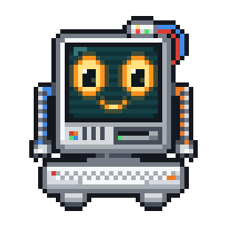
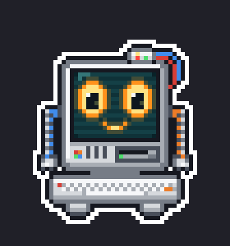
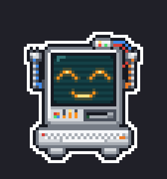
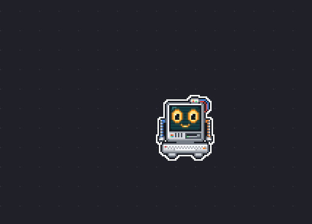
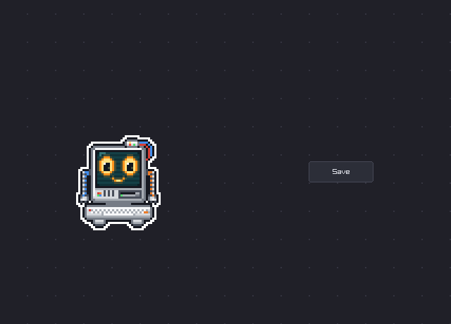
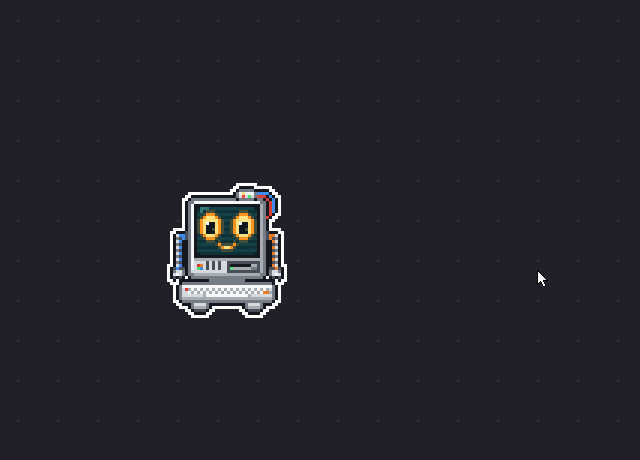

# Manikin

A tiny pixel computer that lives on top of your windows. He chats with you through Claude, walks over and points at stuff on your screen, and if you let him he takes over your mouse and keyboard to do things for you while you watch.

Runs on Windows 11 and talks to Claude models, nothing else.

<p align="center">
  
</p>

So i wanted a desktop pet that could actually do stuff. Manikin is that, plus way too many animations. The body is C with raylib, a transparent always on top window where every pixel of him gets drawn from code every frame (no sprite sheets) and every sound is synthesized from code too (no audio files). The brain is Python and talks to Claude. Click him to chat or drag him around. If you ignore him for a while he falls asleep on you.

## what he does

<table>
  <tr>
    <td align="center" width="33%"><br>his eyes follow your cursor (hover right between them and he goes cross-eyed)</td>
    <td align="center" width="33%"><br>every reply comes with a mood and he acts it out, 10 of them</td>
    <td align="center" width="33%"><br>leave him alone long enough and he yawns, nods off and snores</td>
  </tr>
  <tr>
    <td align="center"><br>pick him up and he panics, shake him hard and he gets dizzy</td>
    <td align="center"><br>Ctrl+Q and he waves bye, then switches off like an old CRT</td>
    <td align="center"><br>he walks his whole window across the screen on those little feet</td>
  </tr>
</table>

### "where is that?" (he points at it)

<p align="center">
  
</p>

Ask him something like "where do i change my display resolution". He looks at the window youre working in, finds the setting and walks over to point at it with his cable arm, then celebrates when you click it. If it takes a few steps he does one at a time and waits for your click before showing you the next one.

Finding the spot takes one screenshot to Claude Haiku through the computer use tool. Then Windows UI Automation snaps that guess to the real button so the ring goes around the whole control.

### "do it for me" (he takes the wheel)

<p align="center">
  
</p>

My favourite part. Ask him to fill in a form and he shows you his plan in the bubble with three buttons: a tick for just this once, a double tick to trust him for the rest of the session, or an X.

Say yes and he walks over to your mouse pointer, plugs his cable into it and drags the real thing around the screen. Every click goes *clack*. He types on his own little keyboard while the letters show up in the real app and narrates what hes doing in his bubble, then lets go and does a little victory hop at the end.

<p align="center">
  
</p>

Some things are never his though. Passwords, payments and deleting stuff get handed back to you: he walks over, points at it, says "Your turn: the password." and waits until you tell him youre done. Pressing submit, sending or posting something, closing a window with unsaved work and the last button of an installer always get a yes/no from you first, even if you trusted him for the whole session. Windows running as admin (UAC prompts included) are off limits completely since Windows blocks his clicks there anyway.

Before every single action plain Python checks what UI Automation says about the thing hes about to touch (is it a password box? a button called Submit?) and picks go, ask or hand over, so Claude never gets a vote. Permissions work the same way, a yes only ever comes from you clicking his button.

You can also just grab the mouse. He lets go the second you move it ("oh, it's yours!") and asks if he should carry on once youre done, and Esc stops him from any app.

<p align="center">
  
</p>

### the rest

- He remembers things about you in an encrypted notes file. On first launch he asks you to pick a password (Argon2id turns it into the key, Fernet seals the notes). Press Esc to skip it and he forgets everything when you close him.
- Reminders: "remind me in 20 min to take the pizza out". They survive restarts, and one that came due while he was closed gets announced the next time you start him.
- Sometimes he talks first. You get a greeting when he starts and a comment when you poke him awake, plus he notices a CPU or GPU thats cooking, RAM running out, a dying battery or that its 2am and youre still up. Tell him to talk less (or to stop talking on his own) and he will.
- Web search and opening links just work. Opening apps or files, reading your clipboard or a file and taking screenshots ask you first, and the only place he can write files is his own sandbox folder.
- Sound is chiptune blips for everything plus a little babble voice while he talks. Ask for "volume 20" or "mute", or hit Ctrl+M.

## how it works

The overlay and the brain are separate programs that talk over a pipe:

```
companion.exe (C + raylib)  <--- one JSON object per line --->  python brain  <--->  Claude API
  his window, his body, the bubble       (his stdin/stdout)         chat + tools
  walking, pointing, the real mouse                                 permission gate
  sounds                                                            safety rules
```

The C side starts the brain as a child process so nothing else on your PC can send him commands. 60 times a second the overlay checks whether the cursor is over a pixel he actually drew and only catches the mouse if it is. Everywhere else is click-through.

He gets drawn into a 40x48 grid of palette letters ('T' is his teal screen, 'O' the orange glow of his eyes, 'K' the outline...) and each cell becomes a 3x3 block on screen. Every animation idea is its own module (gaze, emotions, sleep, getting dragged, pointing, driving, bye). They only read inputs and report moments like "a foot came down" or "he clicked", which the sound code turns into blips. Because none of them touch Windows or audio, `make showreel` can record all of it without running the app. Every GIF in this README came out of it.

The brain runs one turn at a time. Replies stream in and the system prompt never changes mid session, so prompt caching keeps hitting. Every tool call goes through the permission gate before it runs. It uses three Claude models:

| job | default | setting |
|---|---|---|
| chatting | `claude-opus-5-5` | `MANIKIN_MODEL` |
| finding things to point at | `claude-haiku-5-5` | `MANIKIN_POINT_MODEL` |
| driving the mouse and keyboard | `claude-haiku-5-5` | `MANIKIN_DRIVE_MODEL` |

I use `claude-sonnet-5-5` for chatting day to day. Haiku is plenty for driving, filling a form with it costs me about a fifth of a cent.

## build and run

You need:

- Windows 11
- Visual Studio or the Build Tools with the "Desktop development with C++" workload (make.bat finds it by itself, no dev prompt needed)
- Python 3.14 (thats what i use)
- an Anthropic API key

From the repo folder:

    .\make.bat setup
    copy .env.example .env

Put your key in `.env`, then:

    .\make.bat run

First launch asks for the password that locks his memory (6+ characters). He parks himself in the bottom right corner above the taskbar.

No API key? Echo mode works without one, he just repeats what you type. You can still try pointing and driving by hand with commands like `point 1200 400`, `drive demo 800 400` or `drive type hello`:

    set MANIKIN_BACKEND=echo
    .\make.bat run

(In PowerShell thats `$env:MANIKIN_BACKEND="echo"`. This one has to be a real environment variable, it doesnt work from `.env`.)

## controls

| what | how |
|---|---|
| chat | click him, type, Enter |
| move him | drag him |
| stop whatever hes doing | Esc (works from any app while hes driving) |
| answer him | the buttons in his bubble |
| old lines | scroll the mouse wheel over him or his bubble |
| mute / unmute | Ctrl+M (click him first so his window has focus) |
| quit | Ctrl+Q (same) |

## settings

These go in `.env` next to make.bat:

| variable | what it does |
|---|---|
| `ANTHROPIC_API_KEY` | your key |
| `MANIKIN_MODEL` | chat model, default `claude-opus-5-5` |
| `MANIKIN_EFFORT` | chat effort: low, medium (default), high, xhigh or max |
| `MANIKIN_POINT_MODEL` | model that finds things on screen |
| `MANIKIN_DRIVE_MODEL` | model that drives the mouse and keyboard |
| `MANIKIN_DRIVE_EFFORT` | effort for driving, default medium |

Permissions live in `build\data\permissions.json`. Each tool can be `allow`, `ask` or `deny`:

```json
{ "take_screenshot": "deny", "open_url": "ask" }
```

Out of the box `open_app_or_file`, `read_clipboard`, `read_file`, `write_file`, `take_screenshot`, `point_at` and `drive` ask first and the rest just run.

The rest of his stuff is in `build\data` too (`brain.log`, `settings.json`, `notes.enc`, `reminders.json`) and his sandbox is `build\sandbox`. `make clean` leaves both folders alone.

## dev stuff

| command | what it does |
|---|---|
| `make` | build `build\companion.exe` |
| `make run` | build and start him |
| `make console` | build with a console window and run it (for printf debugging) |
| `make preview` | render his built in moods to `build\preview.png` |
| `make anim X` | render one animation module (emotion, gaze, sleep, physics, point, bye, wheel) |
| `make showreel` | record every animation in real time as GIFs in `build\showreel` |
| `make sounds` | open the soundboard to play and tune every sound |
| `make sounds check` | check every sounds length and level |
| `make icon` | redraw his app icon from the sprite |
| `make test` | Python tests for the brain |
| `make ctest` | C tests for pointing, driving and input |

(In PowerShell use `.\make.bat` instead of `make`.)

```
src/            the overlay: window, drawing, animation, sound, pointing, driving
brain/manikin/  the brain: Claude, tools, permissions, safety rules, memory
brain/tests/    Python tests (no API needed)
tools/          preview, showreel, soundboard, icon maker and the C tests
vendor/         raylib 6.2 and cJSON
```

## known limits

- Windows 11 only. The window tricks, the input and UI Automation are all Win32.
- Claude only.
- He cant drive windows running as admin.
- The safety rules go by what UI Automation calls things. An icon button with no name or an app that draws its own UI (games, canvas web apps) gives them nothing to read, so in there its your plan approval and Esc that keep him in line. The keywords are English only too.
- He shows up in his own screenshots. Thats on purpose, hiding him from captures would hide him from your screen recordings too.

## license

MIT, see [LICENSE](LICENSE). raylib (zlib) and cJSON (MIT) keep their own licenses in `vendor/`.

[This project was built collaboratively with LLM coding assistants.]
